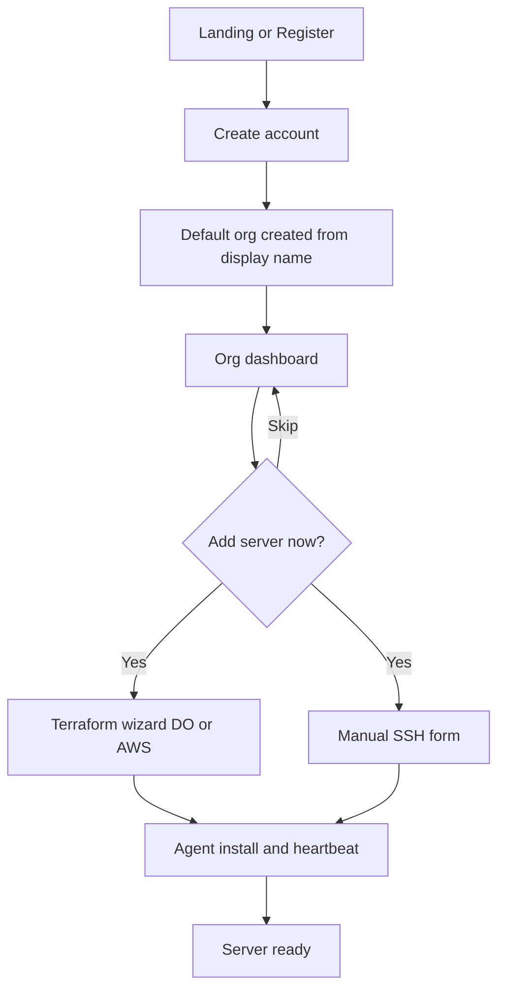
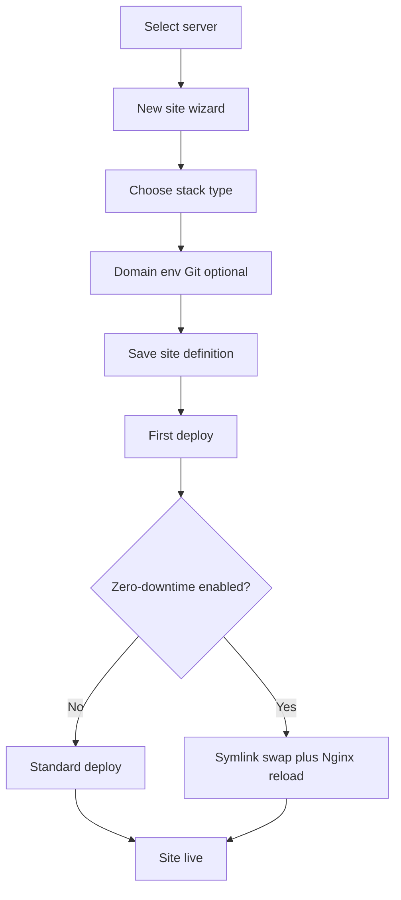
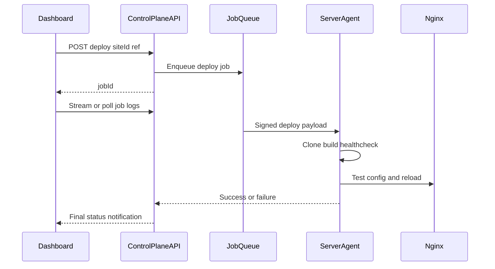

# Design & UI flow

How Outpost maps onto the [Nuxt UI dashboard template](https://dashboard-template.nuxt.dev/) in this folder. Target information architecture and flows are **Planned**; current routes are mostly **Template demo**.

Product capabilities: [../../docs/FEATURES.md](../../docs/FEATURES.md). Frontend boundaries: [SCOPE.md](SCOPE.md).

## Design principles

- **Organization-first:** All infrastructure objects belong to an org; the sidebar header switcher is the primary tenancy control.
- **Progressive depth:** Org dashboard → server → site; each level adds contextual sub-navigation.
- **Operations visible:** Deploy status, agent health, and cert expiry appear on overview surfaces, not buried in settings.
- **Template reuse:** Keep `UDashboardGroup`, panel/navbar/toolbar patterns; replace demo labels and mock APIs incrementally.

## Information architecture

### Global shell (authenticated)

Implemented today in `app/layouts/default.vue`:

| Region | Template component | Outpost role |
|--------|-------------------|--------------|
| Sidebar header | `TeamsMenu` | **Organization switcher** — list orgs, create org |
| Sidebar body | `UNavigationMenu` | Primary product nav |
| Sidebar footer | `UserMenu` | Account menu (profile, logout, API tokens) |
| Top-level | `UDashboardSearch` | Jump to servers, sites, settings |
| Overlay | `NotificationsSlideover` | Org activity & alerts |

### Primary sidebar (target)

Replace demo links in `default.vue` with:

| Item | Route (target) | Replaces / pattern |
|------|----------------|-------------------|
| Dashboard | `/` | `app/pages/index.vue` — org KPIs, recent deploys, alerts |
| Servers | `/servers` | Table UX from `app/pages/customers.vue` |
| Sites | `/sites` | Same table pattern; optional server filter |
| Organization | `/organization/*` | Nested nav like `app/pages/settings.vue` |
| — General | `/organization` | Org name, avatar, danger zone |
| — Members | `/organization/members` | `settings/members` + `MembersList` |
| — Billing | `/organization/billing` | Plans, usage, invoices |
| — Notifications | `/organization/notifications` | Product notification prefs |
| — Security | `/organization/security` | Org API keys, audit log (**Future**) |

Footer links (Feedback / Help) become docs, status page, or support — **Planned**.

### Server context navigation

When viewing `/servers/:serverId/*`, show secondary nav in `UDashboardToolbar` (horizontal `UNavigationMenu`, same pattern as Organization):

| Tab | Purpose |
|-----|---------|
| Overview | Health, agent, quick stats |
| Sites | Sites on this server |
| Runtimes | Node/PHP/Redis/DB versions |
| Services | Background processes |
| Cron | Scheduled jobs |
| Logs | Server-level logs |
| Firewall | Network rules |
| Settings | SSH metadata, maintenance, decommission |

Breadcrumb: `{Org} / Servers / {hostname} / {tab}`.

### Site context navigation

When viewing `/servers/:serverId/sites/:siteId/*`:

| Tab | Purpose |
|-----|---------|
| Deployments | History, trigger deploy, zero-downtime status |
| Environment | Env vars, build settings |
| Domains & SSL | Hostnames, certificates |
| Database | DB users, connection info |
| Network | Redirects, basic auth, site firewall |
| Logs | Access, error, application |
| Nginx | Generated config preview, snippets (admin) |

Breadcrumb: `{Org} / {hostname} / {site} / {tab}`.

## Layouts

| Layout | Use |
|--------|-----|
| `default` | Authenticated app (existing) |
| `auth` | Login, register, forgot password — **Planned**; centered card, no sidebar |
| `marketing` | Public landing — **Future** |

Auth pages must not mount `UDashboardGroup` so unauthenticated users never see org nav.

## User flows

### Onboarding (register → first server)



### Create site and deploy



### Deploy sequence (control plane)



### Invite member

1. Admin opens Organization → Members → Invite.
2. Enter email + role → API sends invite.
3. Invitee accepts (new register or login) → membership active.
4. RBAC applies on next request; UI refreshes org context.

### Upgrade plan

1. Owner opens Organization → Billing → Change plan.
2. Payment provider checkout or confirm proration (**Planned**).
3. API updates entitlements; UI shows new limits.
4. If over limit, block new creates until user reduces usage or upgrades.

## Page building blocks

Every new authenticated screen should follow template conventions:

### Standard page

```text
UDashboardPanel
  #header
    UDashboardNavbar (title, sidebar collapse, actions)
    UDashboardToolbar (optional filters/tabs)
  #body
    content
```

Reference: `app/pages/index.vue`, `app/pages/customers.vue`.

### Section hub (Organization, Server, Site)

Parent page owns horizontal tabs; child routes render in `<NuxtPage />`.

Reference: `app/pages/settings.vue` + `app/pages/settings/*.vue`.

### Lists

- `useFetch` / `$fetch` against API (today: mock `server/api/*`).
- TanStack Table via Nuxt UI table columns, row actions dropdown, bulk select where useful.
- Empty states with primary CTA (e.g. “Add server”).

### Forms

- Nuxt UI form controls + Zod schemas in `app/utils` or colocated `*.schema.ts`.
- Multi-step wizards for Terraform and “New site” (steps component or routed substeps).

### Modals

- Destructive actions: typed confirmation (server name, site domain).
- Pattern from `app/components/customers/DeleteModal.vue`.

## Template → Outpost mapping

| Template route | Outpost direction |
|----------------|-------------------|
| `/` Home | Org dashboard (servers count, deploy activity chart) |
| `/customers` | `/servers` or generic resource table pattern |
| `/inbox` | Remove or repurpose as “Support” **Future** |
| `/settings/*` | `/organization/*` + user account under `UserMenu` |
| `TeamsMenu` | Real org list from API |
| `useDashboard` shortcuts | Update `g-h`, `g-s`, etc. to new routes |

Suggested keyboard shortcuts (**Planned** extension to `app/composables/useDashboard.ts`):

| Shortcut | Action |
|----------|--------|
| `g-d` | Go to dashboard |
| `g-v` | Go to servers |
| `g-i` | Go to sites |
| `g-o` | Go to organization settings |
| `n` | Toggle notifications (existing) |

## Visual & UX

- Primary color: green (`app/app.config.ts`) — keep unless branding changes.
- Status colors: success (healthy/deploy ok), warning (degraded/cert expiring), error (failed job).
- Long operations: inline progress + link to job log; do not block entire shell.
- Agent offline: banner on server and dependent sites.

## Empty & error states

- No servers: dashboard CTA to Terraform or manual add.
- No sites on server: server overview CTA to create site.
- API unreachable: `app/error.vue` with retry; preserve org context when possible.

## Accessibility

- Rely on Nuxt UI + `@nuxt/a11y` module already in `nuxt.config.ts`.
- Tables: row actions reachable via keyboard; announce deploy status changes in live regions where feasible.
