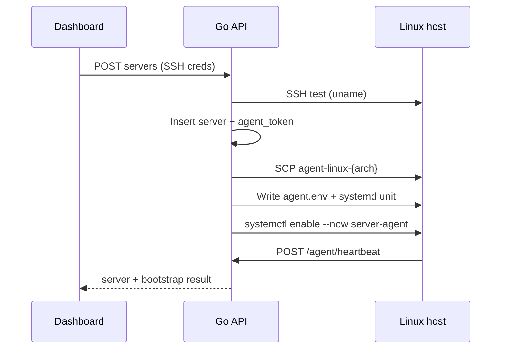

# Agent

On-server process that keeps a machine connected to the control plane. Source: [`agent/`](../agent/).

## Role

- Runs on each managed host (systemd unit `server-agent`).
- **Outbound HTTPS** to the API (works behind NAT).
- Sends **heartbeats** (version, hostname).
- **Polls** for jobs, runs allowlisted handlers, reports results.
- Does **not** accept arbitrary shell from the UI — only registered job kinds.

## Install layout (after API bootstrap)

| Path | Purpose |
|------|---------|
| `/usr/local/bin/server-agent` | Binary |
| `/etc/server-agent/agent.env` | `API_URL`, `SERVER_TOKEN`, intervals |
| `/etc/systemd/system/server-agent.service` | Unit (`EnvironmentFile` + restart) |

Env file shape:

```bash
API_URL=http://192.168.1.50:8080
SERVER_TOKEN=<per-server token>
HEARTBEAT_INTERVAL=15s
POLL_INTERVAL=5s
```

## Bootstrap flow



Arch detection: remote `uname -m` → `x86_64`/`amd64` or `aarch64`/`arm64`. Matching file must exist under `AGENT_BIN_DIR` (default `api/bin/`).

## Protocol (v1)

Header: `Authorization: Bearer <SERVER_TOKEN>`, `X-Agent-Protocol: 1`.

| Call | Path | Notes |
|------|------|--------|
| Heartbeat | `POST /api/v1/agent/heartbeat` | Body: `protocol_version`, `agent_version`, `hostname`. Response bare JSON: `{ ok, protocol_version }` (not the usual `{success,data}` envelope). |
| Next job | `GET /api/v1/agent/jobs/next` | `204` if none; else `{ id, kind, payload }` (`id` is an opaque UUID). |
| Result | `POST /api/v1/agent/jobs/:id/result` | `{ ok, message, exit_code, secrets? }`. `secrets` carries one-time addon credentials after provision. |

### Job kinds

| Kind | Payload | Behavior |
|------|---------|----------|
| `ping` | — | Health check (`pong`). |
| `server.provision` | `php_versions[]`, `node_versions[]`, `addons{redis,mysql,mariadb,postgres}` | Ubuntu/Debian only: nginx, certbot, Composer, packages.sury.org multi-PHP, fnm Node, optional DB/cache. MySQL **or** MariaDB (not both). Creates managed DB user `sm`, disables password/`root` remote login (MySQL/MariaDB socket-only root; Postgres `postgres` password scrambled, not returned), Redis `requirepass`. Secrets returned once for UI reveal. |
| `runtime.php.install` | `version`, `set_default?` | Install one allowlisted PHP (8.1–8.5) + FPM; optional `update-alternatives` for CLI `php`. |
| `runtime.node.install` | `version`, `set_default?` | `fnm install`; links `node`/`npm` into `/usr/local/bin` when defaulting or if `node` missing. |
| `runtime.php.default` / `runtime.node.default` | `version` | Apply CLI default on the host (`update-alternatives` / `fnm default` + symlinks). |
| `runtime.php.remove` / `runtime.node.remove` | `version` | Reserved; currently fail closed. |

Catalog (API): PHP `8.1`–`8.5`, Node `18`/`20`/`22`/`24`. Inventory on server: `{ php: { default, versions[{version,status}] }, node: {...}, addons[] }` with status `installed` \| `installing` \| `failed`.

Org routes (JWT): `POST .../servers/:id/provision`, `GET/POST .../runtimes`, `GET .../runtimes/catalog`, `PATCH .../runtimes/default`, `GET .../jobs/:job`.

Agent package layout:

```text
agent/
  main.go                 # config → client → loop
  internal/config/        # env
  internal/protocol/      # wire types + version
  internal/client/        # HTTP
  internal/loop/          # heartbeat + poll
  internal/executor/      # job handlers (ping, provision, runtimes)
```

Add capabilities by registering handlers in `executor` (fail closed for unknown kinds). Rebuild/redeploy the agent binary after new kinds land.

## Local debug

```bash
cd agent
export API_URL=http://localhost:8080
export SERVER_TOKEN=...   # from create response or servers.agent_token
go run .
```

On a guest after install, use systemd (it loads `/etc/server-agent/agent.env`):

```bash
systemctl status server-agent
journalctl -u server-agent -f
cat /etc/server-agent/agent.env
```

Running the binary by hand also reads that env file (rebuild/redeploy agent after this change). Check the file exists if config errors persist.

## Security notes

- Per-server token authenticates the agent (not the user JWT).
- SSH credentials are stored on the API for bootstrap/retry; never returned in list/get responses.
- Host key verification is currently accept-any (home-lab); pin known_hosts before production.
- Future: mTLS or rotating agent credentials ([ARCHITECTURE.md](ARCHITECTURE.md)).
