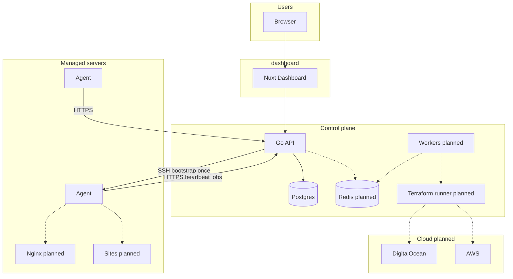
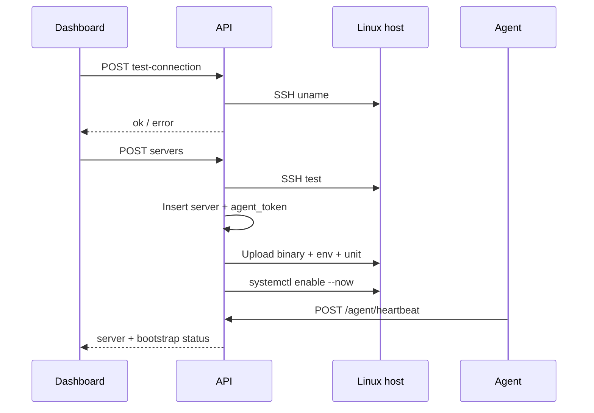
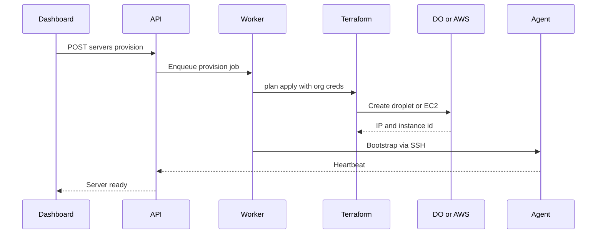

# Architecture

Outpost is a **multi-component system** in the `server-management` monorepo. This document covers the control plane, agent, provisioner, and data layer. The Nuxt dashboard is documented under [dashboard/](../dashboard/).

## System overview



## Components

| Component | Location | Technology | Status / responsibility |
|-----------|----------|------------|-------------------------|
| Dashboard | `dashboard/` | Nuxt 4, Vue 3, Nuxt UI | Auth, orgs, members, servers UI; Nitro proxy to API |
| Control plane API | `api/` | Go, Gin, GORM, Postgres | Auth, orgs, RBAC, server CRUD, SSH test/bootstrap, agent API |
| Agent | `agent/` | Go | Heartbeat + job poll; systemd on host |
| Job workers | with API | Go + Redis | Planned — long deploys / TF |
| Provisioner | `terraform/` | Terraform | Planned — DO/AWS |
| Queue / cache | — | Redis | Planned |

## Trust boundaries

1. **Browser ↔ Dashboard:** Static/SSR assets; no SSH secrets in the client after submit (sent once to API).
2. **Dashboard ↔ API:** Bearer token cookie (`outpost_token`); same-origin `/api/v1` proxy. See [dashboard/docs/API.md](../dashboard/docs/API.md).
3. **API ↔ Agent:** Agent initiates HTTPS with per-server `SERVER_TOKEN`. Protocol v1 today; mTLS later (**TBD**).
4. **API ↔ host (bootstrap only):** API SSHs with stored key/password to install/upgrade the agent. UI never opens SSH.
5. **API ↔ Cloud providers:** Planned — org credentials encrypted at rest.

### Security requirements (non-negotiable)

- No arbitrary shell execution from UI; allowlisted agent job kinds only.
- RBAC on API; UI `can(Ability…)` checks are advisory.
- Secrets (SSH keys, passwords, agent tokens) not returned on list/get; create may return `agent_token` once.
- Host key verification: accept-any for home-lab speed — pin `known_hosts` before production.

## Multi-tenancy

- `organization_id` on tenant resources (servers, …).
- Users belong to many orgs via `organization_members`.
- Hostname unique per organization.
- Billing entitlements per org (planned enforcement beyond UI stubs).

## Manual server + agent flow (implemented)



See [AGENT.md](AGENT.md) and [DEVELOPMENT.md](DEVELOPMENT.md).

## Agent model

The agent will maintain **desired state** from the control plane:

| Domain | Agent actions | Status |
|--------|----------------|--------|
| Heartbeat / jobs | Poll, `ping` handler | Done |
| Deploy | Clone/build, release swap | Planned |
| Nginx | Render vhost, reload | Planned |
| Runtimes | Install Node/PHP | Planned |
| Cron / services | Config + reload | Planned |
| Logs | Tail → API | Planned |
| Firewall | Apply rules | TBD |

## Terraform provisioning flow (planned)



Same agent bootstrap path as manual servers once the instance has SSH.

## Real-time

- Deploy and provision logs: SSE or WebSocket from API (**planned**).
- Notifications: poll or push to dashboard UI.

## Observability (Future)

- API/agent: structured logs, metrics, tracing.
- Dashboard: optional error reporting.

## Repository layout

```text
server-management/
  dashboard/     # Nuxt UI
  api/           # Go control plane
  agent/         # On-server agent
  terraform/     # DO/AWS modules (planned)
  docs/          # Platform docs
```

Agent ↔ API: `protocol_version` on heartbeat; bump when wire format breaks.
