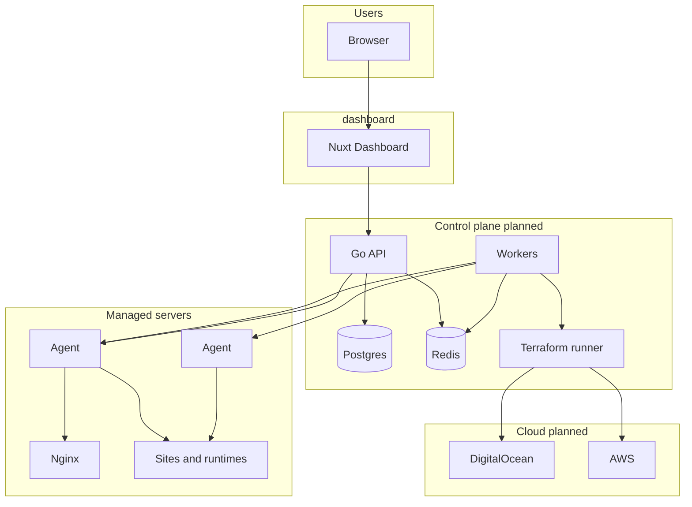
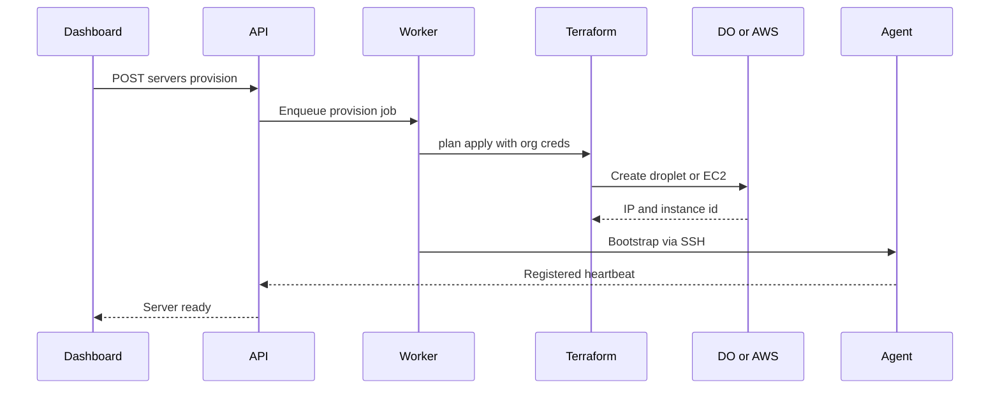

# Architecture

Outpost is a **multi-component system** in the `server-management` monorepo. This document covers the control plane, agent, provisioner, and data layer. The Nuxt dashboard is documented under [dashboard/](../dashboard/).

## System overview



## Components

| Component | Location | Technology | Responsibility |
|-----------|----------|------------|----------------|
| Dashboard | `dashboard/` | Nuxt 4, Vue 3, Nuxt UI | UI, form validation, API client, real-time log viewers |
| Control plane API | `api/` (planned) | Go | Auth, orgs, RBAC, billing webhooks, resource CRUD, job enqueue |
| Job workers | with API (planned) | Go + Redis queue | Provisioning, deploys, SSL renewal, long scripts |
| Agent | `agent/` (planned) | Go + bash helpers | On-server desired state: files, Nginx, services, deploys, log tail |
| Provisioner | `terraform/` (planned) | Terraform | DO/AWS modules; invoked by workers, not by browser |
| Data store | (planned) | Postgres | Users, orgs, servers, sites, releases, audit |
| Queue / cache | (planned) | Redis | Job queue, pub/sub for log streams, rate limits |

## Trust boundaries

1. **Browser ↔ Dashboard:** Static/SSR assets; no secrets in client bundles except public config (`apiBase`).
2. **Dashboard ↔ API:** Session cookie or bearer token; HTTPS only in production. See [dashboard/docs/API.md](../dashboard/docs/API.md).
3. **API ↔ Agent:** Mutually authenticated channel (**TBD**: mTLS with rotating certs or signed JWT + nonce). Agent initiates outbound connection (**preferred** for NAT) or API connects via SSH bastion — **TBD**.
4. **API ↔ Cloud providers:** Org-stored credentials encrypted at rest; used only in worker processes.
5. **UI never runs Terraform or SSH directly** — only requests jobs; workers execute with audit trail.

### Security requirements (non-negotiable)

- No arbitrary shell execution from UI; allowlisted commands per stack template.
- Signed job payloads (job ID, org ID, server ID, action, expiry).
- All mutations logged (who, when, resource, outcome).
- RBAC on API; UI role checks are advisory.
- Secrets (SSH keys, DB passwords, provider tokens) never returned in full after creation; reveal-once patterns where needed.

## Multi-tenancy

- Single database schema with `organization_id` on all tenant resources.
- Users may belong to many orgs via `memberships` table (**planned**).
- Server and site identifiers unique within org; global UUIDs for API paths recommended.
- Billing entitlements scoped per org (max servers, sites, seats).

## Agent model

The agent maintains **desired state** from the control plane:

| Domain | Agent actions |
|--------|----------------|
| Deploy | Clone/build, atomic release dir, health check, optional zero-downtime swap |
| Nginx | Render vhost from site spec, `nginx -t`, reload |
| Runtimes | Install Node/PHP versions via scripts |
| Cron / services | Write config, reload supervisor/systemd |
| Logs | Tail files, stream to API |
| Firewall | Apply rule set (**implementation TBD**) |

Agent reports: version, heartbeat, inventory (installed runtimes), job results.

Initial bootstrap: SSH one-time script installs agent binary and registers with org/server token.

## Terraform provisioning flow



State storage: remote backend per environment; org-specific workspaces or tagged resources — **TBD** in Terraform project.

## Real-time

- Deploy and provision logs: SSE or WebSocket from API, subscribed by job ID.
- Notifications: poll or push channel to dashboard notifications UI.

## Observability (Future)

- API and workers: structured logs, metrics, tracing.
- Agent: forward critical errors to control plane.
- Dashboard: optional error reporting (Sentry etc.) — not in scope initially.

## Repository layout (target monorepo)

```text
server-management/
  dashboard/     # Nuxt UI
  api/           # Go control plane (planned)
  agent/         # Go on-server agent (planned)
  terraform/     # DO/AWS modules (planned)
  scripts/       # Shared bash bootstrap (planned)
  docs/          # Platform docs (this folder)
```

Cross-repo versioning: agent ↔ API protocol version negotiated on connect; dashboard displays incompatible agent warnings.
